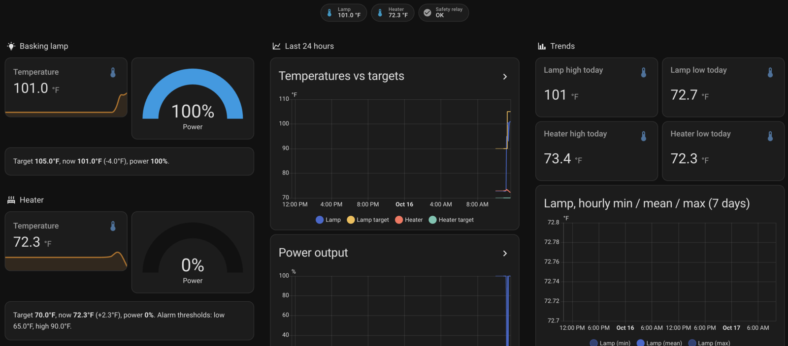

<p align="center">
  
</p>

# Herpstat SpyderWeb for Home Assistant (local)

[](https://hacs.xyz/docs/faq/custom_repositories/)
[](https://github.com/yipe/herpstat/actions/workflows/validate.yml)
[](https://www.home-assistant.io/)
[](https://github.com/yipe/herpstat/blob/main/LICENSE)

Read-only Home Assistant integration for [Spyder Robotics](https://spyderrobotics.com/) **Herpstat SpyderWeb**
reptile thermostats. It polls the thermostat's local `/RAWSTATUS` JSON page over your LAN: no cloud, no login,
and it never changes a setting. The thermostat keeps regulating on its own, so an outage in Home Assistant never
affects heating.


<sub>The [example dashboard](examples/dashboard.yaml) on its first day.</sub>

> Unofficial. Not affiliated with or endorsed by Spyder Robotics. "Herpstat" and "SpyderWeb" are their trademarks.

**Contents:** [Features](#features) · [Requirements](#requirements) · [Install](#install) ·
[Supported devices](#supported-devices) · [Entities](#what-you-get) · [Automations](#automation-examples) ·
[Limitations](#known-limitations) · [Troubleshooting](#troubleshooting) · [Removal](#removal) ·
[Contributing](#contributing)

## Features

- Temperature, setpoint and power for every output, recorded as long-term statistics for charts.
- Problem sensors for probe errors and a tripped safety relay, ready for notifications.
- A Home Assistant repair notice when `/RAWSTATUS` gets switched off, for example by a firmware update.
- Local and read-only, with a retry for the device's occasional cut-off responses.
- Found automatically on your network, and follows the Herpstat when its IP address changes.
- Set up from the UI; **Reconfigure** for manual address changes; redacted **diagnostics** for bug reports.
- An example dashboard and a day-high/night-low statistics package.

## Requirements

- Home Assistant 2025.8 or newer.
- A Herpstat SpyderWeb with **`/RAWSTATUS` enabled**: on the Herpstat's web page go to **Admin**, tick
  **Show Advanced Status Integration Options**, then **Enable /RAWSTATUS Page**, and **Submit**.
  Check it works: `http://<herpstat-ip>/RAWSTATUS` should show JSON.

## Install

**With HACS** (recommended, you get update notifications). If you don't have HACS yet, follow its
[setup guide](https://hacs.xyz/docs/use/) first: download it, restart, then add the **HACS** integration and link
it to GitHub.

[](https://my.home-assistant.io/redirect/hacs_repository/?owner=yipe&repository=herpstat&category=integration)

1. Use the button above: it adds this repository to HACS and opens it. Or add it by hand: HACS → ⋮ →
   **Custom repositories** → `https://github.com/yipe/herpstat`, type *Integration*.
2. On the repository page, click **Download**, then restart Home Assistant.

If HACS says *"Repository 'yipe/herpstat' exists in the store"*, it's already added: search for **Herpstat** in
HACS and download it from there.

**Manual:** copy `custom_components/spyderweb` into your `config/custom_components/` folder and restart.

Then add the integration. Home Assistant usually finds the Herpstat by itself: look under Settings → Devices &
services → **Discovered** (it can take up to an hour, or until the Herpstat reconnects to Wi-Fi). Otherwise:

[](https://my.home-assistant.io/redirect/config_flow_start/?domain=spyderweb)

Or go to Settings → Devices & services → **Add integration** → *Herpstat SpyderWeb (local)* and enter its IP
address. Either way you pick the temperature unit your Herpstat displays (the device doesn't report it).

You usually don't need a fixed IP: when the router gives the Herpstat a new address, Home Assistant notices its
DHCP request and updates the integration by itself.

## Supported devices

Herpstat **SpyderWeb** models (1, 2, 4 and 6 outputs) on firmware that has the `/RAWSTATUS` page (2.7 or later;
2.8+ also reports alarm thresholds). Tested on a Herpstat 2 SpyderWeb, firmware 5.2. Other output counts and
humidity probes are handled from the payload but not yet tested on real hardware: reports welcome.
Herpstats without Wi-Fi (non-SpyderWeb) can't be supported.

## What you get

One device per Herpstat. Entity names use the output nicknames set on the device (e.g. "Lamp temperature").

| Per output | Notes |
|---|---|
| Temperature, setpoint, power % | Recorded as long-term statistics (history charts) |
| Humidity | Only if a humidity probe is connected |
| Problem | `on` when the output reports an error code; code and description in attributes |
| Ramping | `on` while a temperature ramp is running; raw device text in the `status` attribute (diagnostic) |
| High/low alarms enabled | Whether the output's alarms are switched on (diagnostic) |
| Mode, max power, alarm thresholds, high/low since reset | Diagnostic |
| End-of-ramp setpoint, error text, humidity max/min | Diagnostic, **disabled by default** (enable in the entity settings) |

Per device: **Safety relay tripped** (problem), relay status text, power-reset count, and internal temperature
(plus its max) on models/firmware that report it.

**Options:** temperature unit. **Reconfigure** (device page → ⋮) changes the IP address if it moves.

## How data is updated

Home Assistant reads `/RAWSTATUS` every **30 seconds**: one small HTTP request per Herpstat. The vendor warns that
polling faster than every 10 seconds can block the thermostat's other tasks, so the interval isn't a setting.
If you need a different interval, [turn off polling for the entry and drive updates from an automation](https://www.home-assistant.io/common-tasks/general/#defining-a-custom-polling-interval),
but stay at 10 seconds or slower.

The device occasionally cuts a response short, so a failed or garbled response is retried once (within the same
10-second timeout) before an update counts as failed. If the Herpstat can't be reached, its entities become
*unavailable* and recover on the next successful update.

## Use cases

- See enclosure temperatures and heater/lamp power from anywhere, with history.
- Get a notification when a probe fails, the safety relay trips, or the thermostat drops off the network.
- Check that a day/night schedule really turns the basking lamp off at night.

## Automation examples

Notify on any problem, or when the Herpstat has been unreachable for 10 minutes:

```yaml
automation:
  - alias: Herpstat problem
    triggers:
      - trigger: state
        entity_id:
          - binary_sensor.herpstat_safety_relay_tripped
          - binary_sensor.herpstat_lamp_problem
          - binary_sensor.herpstat_heat_problem
        to: "on"
      - trigger: state
        entity_id: sensor.herpstat_lamp_temperature
        to: unavailable
        for: "00:10:00"
    actions:
      - action: notify.notify
        data:
          title: Herpstat
          message: "{{ trigger.to_state.name }}: {{ trigger.to_state.state }}"
```

Warn if the basking lamp is still powered at night, whether it never turned off when night began or came back on
later (adjust the times to your schedule; here night starts at 20:00):

```yaml
  - alias: Basking lamp on at night
    triggers:
      - trigger: time  # still on 15 minutes after night began
        at: "20:15:00"
      - trigger: numeric_state  # came back on during the night
        entity_id: sensor.herpstat_lamp_power
        above: 0
        for: "00:15:00"
    conditions:
      - condition: numeric_state
        entity_id: sensor.herpstat_lamp_power
        above: 0
      - condition: time
        after: "20:15:00"
        before: "07:45:00"
    actions:
      - action: notify.notify
        data:
          message: "Basking lamp still at {{ states('sensor.herpstat_lamp_power') }}% power."
```

Entity IDs depend on your device and output nicknames; check yours under Settings → Entities.

## Known limitations

- **Read-only.** Setpoints, schedules and modes are changed on the Herpstat itself.
- **Discovery and IP following need Home Assistant to see the Herpstat's network traffic** (DHCP requests and
  mDNS): same network or VLAN, and host networking if Home Assistant runs in Docker. Otherwise add it by IP address
  and give it a fixed IP. Discovery matches the names seen on a Herpstat 2 (firmware 5.2): DHCP hostname
  `Herpstat2-<MAC>` and mDNS service `Herpstat`.
- **Temperature unit is not reported** by the device; pick it during setup (changeable in the options).
- While the Herpstat's web configuration page is open, `/RAWSTATUS` keeps returning the last values, so readings
  look frozen until you leave it.
- Humidity entities are created when the integration loads; after plugging in a humidity probe, reload the
  integration.
- Only the live status is read; the device's own 5-minute chart history isn't imported.

## Troubleshooting

| Symptom | Fix |
|---|---|
| Repair: "Herpstat /RAWSTATUS is turned off" (often after a firmware update resets settings) | Re-enable it on the Herpstat (see [Requirements](#requirements)); the repair clears itself on the next update |
| Entities unavailable, "Could not reach the Herpstat" | Open `http://<ip>/RAWSTATUS` in a browser. A new IP is normally picked up by itself within the hour; to fix it now, use **Reconfigure** |
| Readings stopped changing | Close the Herpstat's web configuration page |
| Temperatures off by a °F/°C conversion | Integration options → temperature unit must match the Herpstat's display |

For bug reports, attach **Download diagnostics** (device page → ⋮): it contains the raw `/RAWSTATUS` payload with
MAC and IP redacted.

## Removal

1. Settings → Devices & services → **Herpstat SpyderWeb (local)** → ⋮ → **Delete**.
2. Uninstall it in HACS (or delete `config/custom_components/spyderweb`), then restart Home Assistant.
3. Optionally untick **Enable /RAWSTATUS Page** in the Herpstat's Admin page.

## Examples

- [`examples/dashboard.yaml`](examples/dashboard.yaml): a sections dashboard (current readings, alerts, 24 h
  charts, trends). Entity IDs assume a device named `herpstat` with outputs `Lamp` and `Heat`; adjust to yours.
- [`examples/packages/herpstat_day_night.yaml`](examples/packages/herpstat_day_night.yaml): template sensors for
  each day's high (8 AM–8 PM), each night's low (8 PM–8 AM) and their 7-day averages.

## Contributing

Issues and pull requests are welcome.

- **Bugs:** use the [bug report form](https://github.com/yipe/herpstat/issues/new/choose) and attach **Download
  diagnostics** (device page → ⋮). It contains the raw `/RAWSTATUS` payload with MAC and IP redacted.
- **Most wanted:** payloads from models and setups not tested yet: Herpstat 1, 4 or 6 SpyderWeb, humidity probes,
  other firmware versions, and anything in the `ramping` field while a ramp is running.

Development uses [uv](https://docs.astral.sh/uv/) with Python 3.13 and the Home Assistant 2025.8.3 test harness
(the minimum supported version). CI runs these checks, plus the tests against the newest Home Assistant release
every day:

```sh
uv sync
uv run pytest --cov=custom_components.spyderweb --cov-fail-under=95
uv run mypy --strict custom_components/spyderweb
uvx ruff check . && uvx ruff format --check .
```

[`docs/API.md`](docs/API.md) documents the device's HTTP interface as reverse-engineered, and
[`tools/herpstat_client.py`](tools/herpstat_client.py) is a stdlib-only read-only client for it (including the
login-protected 5-minute history).

## License

[MIT](LICENSE)
